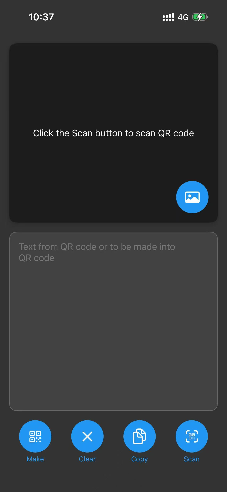
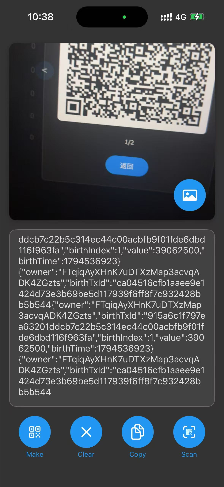
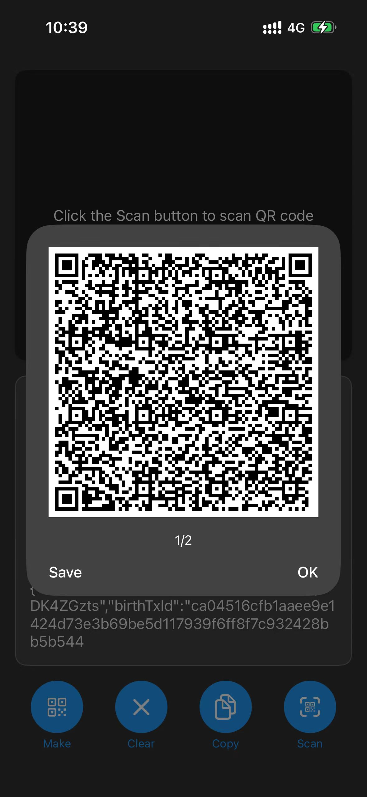

# EasyQR for iOS

A simple QR code scanner and generator for iPhone, ported from the
[Android app](https://github.com/nobodyoffc/EasyQR).

- Scan QR codes with the camera or from a photo in your library.
- Turn any text into a QR code.
- Long text is split automatically into several QR codes (400 bytes each) that
  can be scanned back one after another to rebuild the original text.
- Save generated QR codes to Photos.
- English and Simplified Chinese.

Built with SwiftUI and Apple frameworks only (AVFoundation, Vision, Core Image).
Requires iOS 16 or later. Open `EasyQR.xcodeproj` in Xcode to build.

  
  
  

## Privacy Policy

1. **Introduction.** This Privacy Policy explains how EasyQR handles your
   information. By using the app, you agree to the terms of this policy.
2. **Information we collect.** None. The app does not use the internet and does
   not collect any of your information.
3. **How we use your information.** We do not use any of your information.
4. **Sharing your information.** We do not share any of your information.
5. **Data security.** The app uses your camera only to scan QR codes, reads
   photos only when you pick one to scan, and saves QR codes to your photo
   library only when you tap Save. Everything stays on your device.
6. **Third-party services.** The app contains no third-party services.
7. **Children's privacy.** The app is not directed at children under 4 and does
   not collect data from anyone.
8. **Changes to this policy.** We may update this policy; changes will be
   published on this page.
